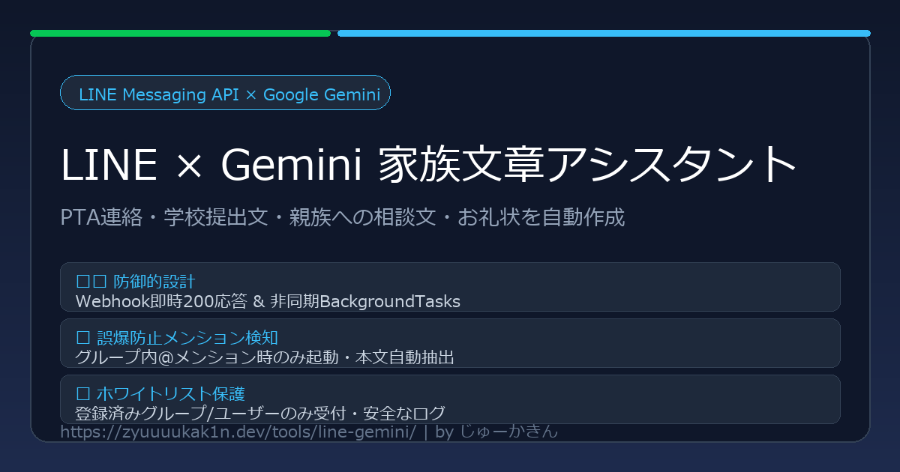

# LINE × Gemini 家族文章アシスタント (line-gemini)



LINE Messaging API と Google Gemini API (gemini-2.5-flash) を連携させ、家族LINEグループ内からの実用的な文章作成依頼（PTA連絡、学校への連絡帳・提出文、家族・親族への相談文、お礼状など）を自動処理するバックエンドBotです。

---

## 💡 特徴・コア機能

- **PTA・学校・親族向け文章の自動作成・推敲**:
  - 送信相手（PTA関係者、学校の先生、親族等）に応じた自然な敬語・丁寧さ・適切な改行・段落分けを自動適用。
  - 「承知いたしました」「いかがでしょうか」などのAI特有の前置き・結びを排除し、**家族がそのままコピペして即座に送信できる完成文面**のみを出力。
- **防御的アーキテクチャ（タイムアウト回避）**:
  - LINEプラットフォームのタイムアウト（数秒以内）を防ぐため、`/callback` 受信時に署名検証後、**即座に 200 OK を返却**。
  - Gemini APIの文章生成およびLINEへの返信処理は、FastAPIの `BackgroundTasks` を利用して非同期に実行。
- **グループチャット誤爆防止・メンション検知**:
  - グループトーク/複数人トークでは、**Botへのメンションが含まれている場合のみ起動**。通常の日常会話はGeminiを呼び出さずスルーします。
  - プロンプトから `@Bot名` のメンション文字列を自動でトリム・除去し、純粋な依頼内容のみをAIへ伝達。
  - 1対1トークではメンション不要でそのまま送信・処理。
- **堅牢なアクセス制御・ホワイトリスト**:
  - 環境変数 `ALLOWED_GROUP_IDS` / `ALLOWED_USER_IDS` によるアクセス制御を実装。
  - 登録外のグループからのリクエストは処理をスキップし、APIリソースとプライバシーを保護。
  - グループ参加時（`JoinEvent`）にコンソールログへ `groupId` を明瞭に出力するため、許可IDの確認・追加が容易。
- **本番運用に最適化されたDocker構成**:
  - 非rootユーザー（`appuser`）による安全なコンテナ実行。
  - ホスト側ループバックアドレス（`127.0.0.1:8090`）への内部バインドとリバースプロキシ連携。

---

## 🛠 技術スタック

| 分類 | 技術 / ライブラリ |
| :--- | :--- |
| **バックエンド** | Python 3.11+, FastAPI, Uvicorn |
| **LINE連携** | line-bot-sdk (v3) |
| **AI生成エンジン** | Google GenAI SDK (`google-genai`) / `gemini-2.5-flash` |
| **コンテナ環境** | Docker, Docker Compose (マルチステージビルド) |
| **設定管理** | pydantic-settings |
| **テスト** | pytest, pytest-asyncio, httpx |

---

## 📁 ディレクトリ構成

```text
line-gemini/
├── .github/
│   └── workflows/
│       └── main.yml            # CIテスト実行 (GitHub Actions)
├── app/
│   ├── __init__.py
│   ├── config.py               # pydantic-settings による環境変数管理
│   ├── gemini_client.py        # Gemini API連携 & システムプロンプト定義
│   ├── line_client.py          # LINE署名検証, メンション検知, 返信処理
│   └── main.py                 # FastAPIエントリポイント, Webhook, BackgroundTasks
├── assets/
│   └── ogp.png                 # OGPバナー画像 (1200x630)
├── tests/
│   ├── __init__.py
│   └── test_webhook.py         # 署名検証, メンション検知, アクセス制御テスト
├── .dockerignore
├── .env.example                # 環境変数のサンプル定義
├── .gitignore
├── compose.yaml                # Docker Compose 定義 (127.0.0.1:8090:8000)
├── DEPLOYMENT_GUIDE.md         # 汎用デプロイガイド
├── Dockerfile                  # 軽量マルチステージ Dockerfile
├── LICENSE                     # MIT License
├── README.md                   # 本ドキュメント
└── requirements.txt            # 依存ライブラリ一覧
```

---

## 🚀 クイックスタート

### 1. 前提条件
- LINE Developers アカウント（Messaging APIチャネル）
  - **重要**: チャネル設定の「グループ・複数人トークへの参加を許可する」を **「有効」** にしてください。
  - 「応答メッセージ」を **「無効」**、「Webhook」を **「有効」** にしてください。
- Google AI Studio の APIキー

### 2. 環境変数の設定
`.env.example` をコピーして `.env` を作成し、必要なキーを設定します。

```bash
cp .env.example .env
```

`.env` の編集項目:
```env
LINE_CHANNEL_SECRET=your_line_channel_secret_here
LINE_CHANNEL_ACCESS_TOKEN=your_line_channel_access_token_here
LINE_BOT_USER_ID=Uxxxxxxxxxxxxxxxxxxxxxxxxxxxxxxxxx
GEMINI_API_KEY=AIzaxxxxxxxxxxxxxxxxxxxxxxxxxxxxxxxxxxxxx
GEMINI_MODEL=gemini-2.5-flash
ALLOWED_GROUP_IDS=Cxxxxxxxxxxxxxxxxxxxxxxxxxxxxxxxxx
ALLOWED_USER_IDS=
PORT=8000
LOG_LEVEL=INFO
```

### 3. Docker Compose による起動
```bash
docker compose up -d --build
```

コンテナのログ確認:
```bash
docker compose logs -f line-gemini-bot
```

### 4. 疎通確認（ローカル）
```bash
curl http://127.0.0.1:8090/health
# {"status":"healthy","service":"line-gemini-bot","model":"gemini-2.5-flash",...}
```

---

## 🧪 テストの実行

```bash
pip install -r requirements.txt
pytest -v
```

テスト項目:
- `/health` および `/` の正常疎通
- 不正署名・署名ヘッダー欠落時の 400 エラー返却
- 正しい署名での即時 200 OK 応答
- グループチャットでのメンション検知・非メンション時のスキップ
- メンション文字列（`@Bot`）の除去・本文抽出
- ホワイトリストによるアクセス制御（未許可グループ/ユーザーの遮断）
- Gemini API呼び出し失敗時のフォールバック返信処理

---

## 📄 ライセンス

本プロジェクトは [MIT License](LICENSE) の下で公開されています。
Copyright (c) 2026 じゅーかきん
